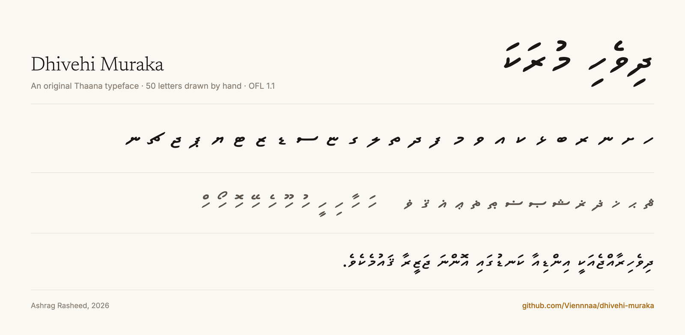

# Dhivehi Muraka

An original Thaana typeface for Dhivehi, covering the complete Unicode Thaana
block: 24 base consonants, naviyani, the 14 Arabic transliteration letters, and
all 11 fili.

**[Open the interactive specimen →](https://viennnaa.github.io/dhivehi-muraka/specimen-interactive.html)**
Type in it, drag the size, and combine any consonant with any fili.

## Provenance

Every Thaana outline in this font was drawn by hand, point by point. No existing
font was opened, imported, traced, or used as a source of coordinates.

An existing Thaana face was shown on screen as a proportion reference while
drawing — the way a printed specimen would be — but none of its outlines are
present here, and that reference layer is not distributed with this repository.
The build verifies this on every run: each glyph is compared against the
reference and any letter sharing coordinates with it is refused, not shipped.

Latin glyphs come from [Inter](https://github.com/rsms/inter) under the OFL, and
are credited in the font's name table.

## Layout

    fonts/ttf/                  the built font
    sources/drawings.json       the drawings — every point, the actual source
    sources/build/              the scripts that turn drawings into a font
    sources/latin/              the OFL Latin merged in
    documentation/              specimen image
    docs/                       the browsable specimen, served by GitHub Pages
    googlefonts/dhivehimuraka/  Google Fonts submission directory

## Building

    pip install -r requirements.txt
    ./sources/build/build_all.sh sources/drawings.json

Four steps: outlines from the drawings, then anchors and the `mark` feature,
then the Latin merge, then the specimen.

## Technical

2048 upm · fsType 0 · OS/2 v4 · USE_TYPO_METRICS · italic angle 0
GDEF glyph classes · GPOS `mark` feature under the `thaa` script
252 glyphs · 50 Thaana · 200 Latin · 5,020 kern pairs
FontBakery `check-googlefonts`: 0 FAIL, 152 PASS

## Licence

SIL Open Font License 1.1. See [OFL.txt](OFL.txt).

Designed by Ashrag Rasheed.
